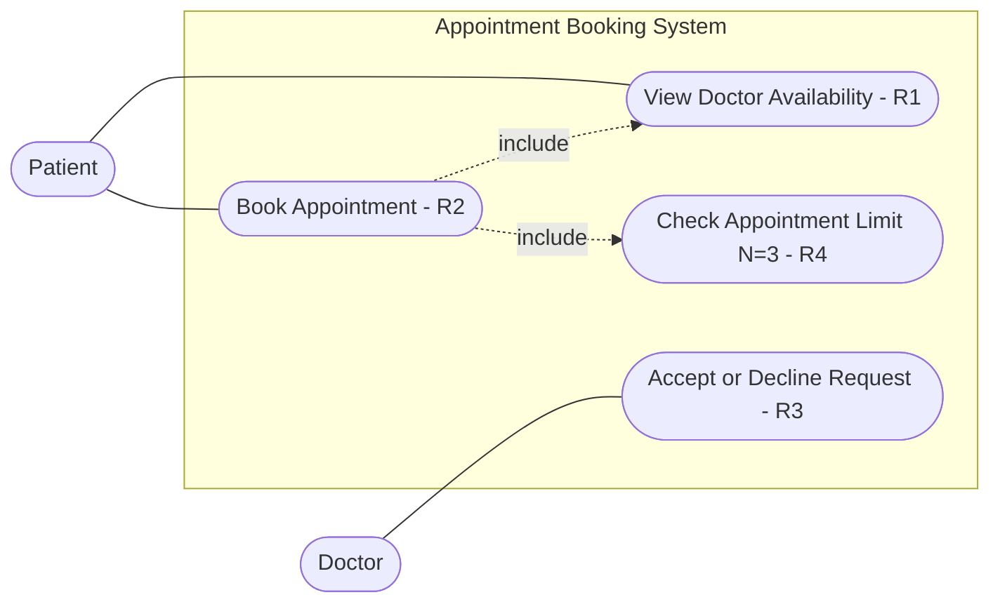

# 2. Use Cases

**System:** Doctor Appointment Booking System
**Actors:** Patient, Doctor
**N = 3** (maximum number of upcoming appointments per patient, see R4)

Only the functional requirements (R1 to R4) are modelled here. R5 to R7 are non-functional and are not use cases.

---

## UC1: View Doctor Availability (R1)

| Field | Description |
|---|---|
| Actor | Patient |
| Goal | See the days and times when a doctor is available |
| Precondition | The doctor has published available time slots |
| Postcondition | The patient sees the list of available slots |

**Main flow**
1. The patient selects a doctor.
2. The system shows the days and times when this doctor is available.

---

## UC2: Book Appointment (R2, R4)

| Field | Description |
|---|---|
| Actor | Patient |
| Goal | Book an appointment in an available time slot |
| Precondition | The doctor has published available time slots |
| Postcondition | An appointment request with status "Pending" is created and sent to the doctor |

**Main flow**
1. The system shows the doctor's available days and times (**include** UC1).
2. The patient selects an available time slot.
3. The system checks the patient's number of upcoming appointments (**include** UC4).
4. The number is less than N (3), so the system creates the appointment request with status "Pending".
5. The system sends the request to the doctor and confirms to the patient.

**Alternative flow A: appointment limit reached (R4)**
- At step 4, the patient already has N = 3 upcoming appointments.
- The system rejects the booking and shows a message that the maximum of 3 upcoming appointments was reached.
- The use case ends and no appointment is created.

---

## UC3: Accept or Decline Appointment Request (R3)

| Field | Description |
|---|---|
| Actor | Doctor |
| Goal | Respond to a patient's appointment request |
| Precondition | There is an appointment request with status "Pending" |
| Postcondition | The request status is "Accepted" or "Declined" |

**Main flow**
1. The doctor opens a pending appointment request.
2. The doctor accepts the request.
3. The system changes the status to "Accepted" and notifies the patient.

**Alternative flow A: doctor declines**
- At step 2, the doctor declines the request.
- The system changes the status to "Declined", frees the time slot, and notifies the patient.

---

## UC4: Check Appointment Limit (R4)

| Field | Description |
|---|---|
| Actor | none (included by UC2) |
| Goal | Make sure the patient does not exceed N upcoming appointments |

**Main flow**
1. The system counts the patient's upcoming appointments.
2. The system returns "allowed" if the count is less than N (3), otherwise "not allowed".

---

## Use Case Diagram

