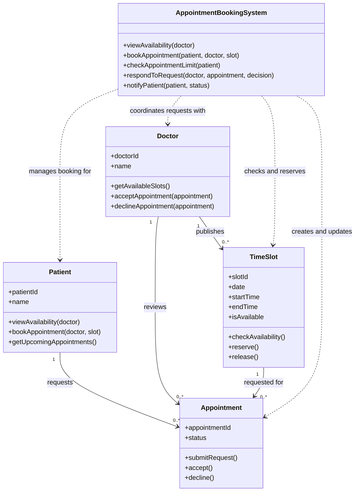

# Class Diagram (P5)

**Business rule:** A patient may have at most 3 upcoming appointments at
any given time (N = 3).

**Design note:** A time slot can be linked to multiple appointment
requests over time---for example, if a doctor declines a request and the
slot is released. The system must prevent conflicting active bookings
for the same slot.
