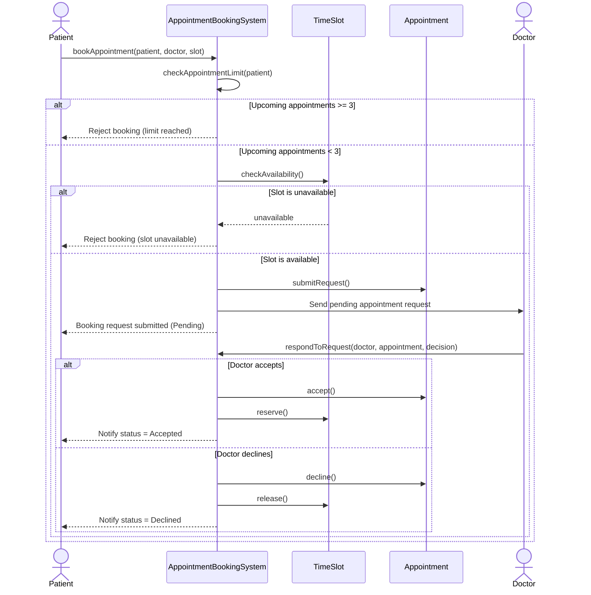

# Sequence Diagram (P6)

## Explanation

1. The patient requests an appointment through the system.
2. The system checks that the patient has fewer than 3 upcoming appointments.
3. The system checks whether the selected time slot is available.
4. If both checks pass, the system creates a pending appointment request and sends it to the doctor.
5. The doctor accepts or declines the request.
6. If accepted, the slot is reserved. If declined, the slot is released and the patient is notified.
